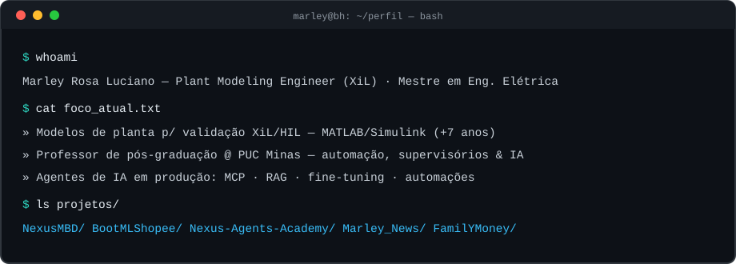
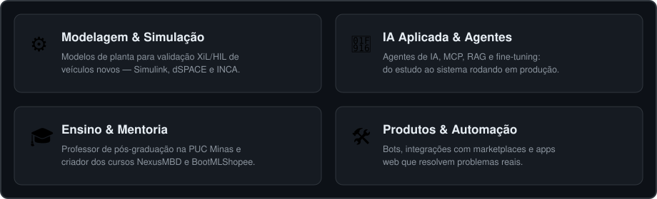
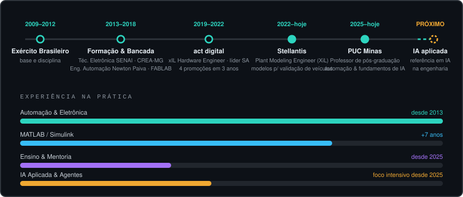

 

  

 

  

> **About (EN):** Automation and electrical engineer with a master's degree in Electrical Engineering. Plant Modeling Engineer (XiL) in the automotive industry — plant models for XiL/HIL validation of new vehicles with MATLAB/Simulink for 7+ years. Graduate professor at PUC Minas. I build AI agents, automation and web systems — several of them running in production.

---

## 🎯 Áreas de atuação

  

---

## 🧰 Arsenal

**Engenharia & Simulação**

`Simulink` · `dSPACE` · `INCA` · `ControlDesk` · `CANalyzer` · `Databricks`

 

**Desenvolvimento & IA**

`Agentes de IA` · `MCP` · `RAG` · `Fine-tuning` · `LLMs` · `GitHub Copilot` · `Claude` · `Gemini`

---

## 🛤️ Trajetória

  

---

## 🚀 Projetos em destaque

| Projeto | O que é |
|---|---|
| **[NexusMBD — AI-Native Powertrain Engineering Suite](https://github.com/marleyrosa/NexusMBD)** | Curso de 60h que une Model-Based Design com MATLAB/Simulink aos 4 pilares da IA aplicada à engenharia: MCP, RAG, agentes e fine-tuning. 8 apostilas, slides PT/EN, capstone e certificado. |
| **[BootMLShopee](https://go.hotmart.com/E108290999X)** | Curso prático para criar bots automáticos de ofertas para Mercado Livre e Shopee no WhatsApp, com infraestrutura de baixo custo e software livre. Nasceu de um bot real que opera 24/7 divulgando ofertas de afiliado. |
| **[Nexus Agents Academy](https://github.com/marleyrosa/Nexus-Agents-Academy)** | Curso interativo de agentes de IA: 8 módulos × 6h, laboratórios práticos e um cockpit com agente didático que responde com RAG e aprovação humana. |
| **[Marley_News](https://github.com/marleyrosa/Marley_News)** | Briefing executivo diário gerado por IA (Python): coleta, resume e ranqueia notícias de engenharia, automotivo e tecnologia, com entrega por e-mail e WhatsApp. |
| **[FamilYMoney](https://github.com/marleyrosa/family-finance-frontend)** | App web de finanças familiares: Next.js + FastAPI + PostgreSQL, com leitura de boletos em PDF, relatórios mensais e PWA instalável. |
| **[DayliShoot](https://github.com/marleyrosa/dayshoot)** | E-commerce de shots matinais naturais: loja própria leve + hub Node.js de integração com o Mercado Livre (pedidos, estoque e perguntas). |

---

## 🎓 Ensino & conteúdo

---

## 🎮 Fora do terminal

---

## 📊 Stats

 

---

*Motivação que guia tudo isso: criar coisas novas, aprender sempre, ajudar e compartilhar conhecimento.*

